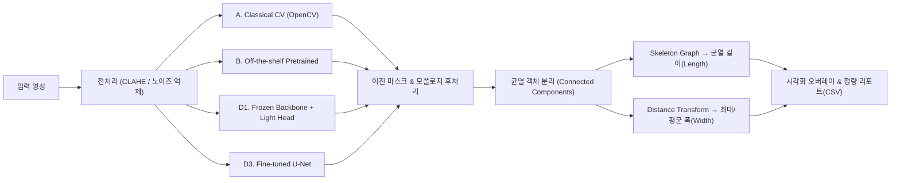

# Structural Crack Segmentation & Geometric Quantification Pipeline

콘크리트 및 건축물 외벽 영상에서 **균열(Crack) 객체를 픽셀 단위로 분할(Segmentation)**하고, 검출된 균열의 **길이(Length)와 폭(Width)을 기하학적으로 정량 추정**하는 컴퓨터 비전 파이프라인입니다.

실제 시설물 안전 점검 현장에서는 점검 대상 건물마다 라벨링된 학습 데이터를 새로 구축하기 어렵다는 점에 착안하여, **학습 도메인과 평가 도메인을 완전히 분리한 교차 데이터셋 일반화(Cross-Dataset Generalization)** 환경에서 고전 비전 알고리즘과 전이학습 기반 딥러닝 모델의 성능을 비교·검증합니다.

---

## 1. 주요 기능 (Key Features)

1. **다중 패러다임 균열 분할 (Crack Segmentation)**
   - **고전 컴퓨터 비전 (Classical CV)**: CLAHE 조명 보정, Black-hat 모폴로지, 적응형 임계값 및 연결 요소 필터링 기반 베이스라인
   - **사전학습 모델 추론 (Off-the-shelf Pretrained)**: 공개 도로·콘크리트 균열 데이터로 사전학습된 **DeepCrack** 및 **YOLOv8-crack-seg** 모델의 Zero-shot 추론
   - **특징 추출 전이학습 (Feature Extraction)**: ImageNet 사전학습 백본(ConvNeXt / ResNet)을 동결(Freeze)하고 경량 디코더 헤드만 학습
   - **전체 파인튜닝 (Full Fine-tuning)**: 사전학습 인코더-디코더 네트워크(U-Net)를 이종 공개 균열 데이터셋으로 미세조정하여 타겟 도메인 적응력 극대화

2. **균열 객체 분리 및 기하학적 특성 정량화 (Length & Width Estimation)**
   - **개별 균열 분리**: 모폴로지 Closing 및 Connected Components 분석을 통한 균열 인스턴스 분리
   - **길이 추정 (Skeleton Graph)**: 골격화(Skeletonization) 및 잔가지 제거(Spur Pruning) 후, 인접 픽셀 간 직선($1$)·대각선($\sqrt{2}$) 유클리드 거리를 합산하여 곡선 균열의 실제 길이 산출
   - **폭 추정 (Distance Transform)**: 유클리드 거리 변환(Euclidean Distance Transform) 맵을 균열 중심선(Skeleton)을 따라 샘플링하여 균열별 **최대 폭(Max Width)** 및 **평균 폭(Mean Width)** 산출

3. **정량 평가 벤치마크 (Evaluation Benchmark)**
   - **분할 지표**: Pixel IoU, F1-Score (Dice), Precision, Recall, 경계 허용오차(Boundary Tolerance 2px) F1
   - **측정 지표**: Ground Truth 마스크로부터 산출한 기준 길이·폭 대비 예측 길이의 **MAPE(%)** 및 예측 폭의 **MAE(px)**

---

## 2. 데이터셋 구성 및 실험 설계 (Dataset & Experimental Setup)

모델이 학습 데이터셋의 배경 질감에 과적합(Overfitting)되지 않고 **처음 보는 실제 건축물 외벽 환경(Unseen Target Domain)**에서도 강건하게 작동하는지 검증하기 위해, 학습용 데이터셋과 최종 벤치마크 평가용 데이터셋을 엄격히 분리하여 사용합니다.

| 구분 | 데이터셋 | 해상도 / 장수 | 촬영 대상 (Domain) | 프로젝트 내 활용 목적 |
| :--- | :--- | :--- | :--- | :--- |
| **Target Evaluation (Unseen Test Only)** | **CUBIT-Seg (Crack)** | `512×512` / 5,462장 | 드론(UAV) 및 DSLR 기반 **건축물 외벽** | **최종 분할 성능 및 길이·폭 추정 오차 벤치마크 평가 전용** (학습·튜닝에 일절 사용하지 않음) |
| **Target Demo** | **CUBIT-Det** | 최대 `8000×6000` | 건축물, 도로, 교량 | 초고해상도 드론 영상 슬라이딩 윈도우(Tiling) 추론 데모 |
| **Source Training / Adaptation** | **DeepCrack / Bai-2020 / CRACK500** | 다양 (약 4,500+장) | 아스팔트 도로, 콘크리트, 건축물 벽체 | 특징 추출 헤드 학습(D1) 및 파인튜닝(D3), 하이퍼파라미터 검증용 |

---

## 3. 전체 파이프라인 (Pipeline Architecture)



---

## 4. 프로젝트 폴더 구조 (Repository Structure)

```text
.
├── configs/
│   └── default.yaml           # 전처리, 분할 임계값, 길이·폭 측정 파라미터 설정
├── src/
│   ├── data.py                # 데이터셋 로더 및 전처리 파이프라인
│   ├── preprocess.py          # CLAHE 조명 정규화 및 노이즈 필터
│   ├── postprocess.py         # 모폴로지 연산 및 소형 잡음 제거
│   ├── measure.py             # Skeleton 기반 길이 및 Distance Transform 기반 폭 추정
│   ├── metrics.py             # IoU, F1, Tolerance F1, 길이/폭 MAE·MAPE 평가 지표
│   ├── visualize.py           # 마스크 오버레이, 골격, 폭 히트맵 시각화
│   └── methods/               # 균열 분할 알고리즘 모듈 (Classical, Pretrained, Transfer)
├── scripts/
│   ├── check_env.py           # 실행 환경 및 GPU(CUDA) 검증 스크립트
│   ├── train.py               # Source 데이터셋 기반 전이학습 스크립트
│   └── evaluate.py            # CUBIT-Seg 벤치마크 일괄 평가 스크립트
├── notebooks/                 # 데이터셋 탐색(EDA) 및 결과 분석 노트북
├── data/                      # 데이터셋 디렉토리 (Git 추적 제외)
├── weights/                   # 모델 가중치 디렉토리 (Git 추적 제외)
├── results/                   # 벤치마크 평가 결과 CSV 및 로그
└── assets/                    # 시각화 결과 샘플 이미지
```

---

## 5. 환경 설정 및 실행 방법 (Getting Started)

### 5.1 가상환경 생성 및 패키지 설치
```bash
# 1. Python 가상환경 생성 및 활성화 (Windows PowerShell)
python -m venv .venv
.\.venv\Scripts\Activate.ps1

# 2. PyTorch (CUDA 12.4) 설치
pip install torch torchvision --index-url https://download.pytorch.org/whl/cu124

# 3. 필수 패키지 설치
pip install -r requirements.txt

# 4. 프로젝트 패키지 설치 (editable)
pip install -e .

# 5. GPU 및 라이브러리 환경 검증
python scripts/check_env.py
```

---

## 6. 벤치마크 실험 결과 (Experimental Results)

> *실험 진행 후 각 방법론별 CUBIT-Seg (5,462장) 정량 평가 결과가 업데이트될 예정입니다.*

| Method | Paradigm | Trainable Params | Pixel F1 (%) | Tol-F1 (2px, %) | IoU (%) | Length MAPE (%) | Width MAE (px) | Latency (ms) |
| :--- | :--- | :---: | :---: | :---: | :---: | :---: | :---: | :---: |
| **A. OpenCV Morphology** | Classical CV | 0 | TBD | TBD | TBD | TBD | TBD | TBD |
| **B1. Pretrained DeepCrack** | Off-the-shelf | 0 | TBD | TBD | TBD | TBD | TBD | TBD |
| **B2. Pretrained YOLOv8-seg** | Off-the-shelf | 0 | TBD | TBD | TBD | TBD | TBD | TBD |
| **D1. Frozen ConvNeXt + Head** | Feature Extraction | < 0.2M | TBD | TBD | TBD | TBD | TBD | TBD |
| **D3. Fine-tuned U-Net** | Full Fine-tuning | ~24M | TBD | TBD | TBD | TBD | TBD | TBD |

---

## 7. 참고 문헌 및 데이터셋 출처 (References)

- **CUBIT-Seg / CUBIT-Det Dataset**: [CUHK-USR-Group/Defect-Dataset](https://github.com/CUHK-USR-Group/Defect-Dataset)
  - Yang, G., et al. *"Det-Recon-Reg: An Intelligent Framework Toward Automated UAV-Based Large-Scale Infrastructure Inspection"*, IEEE Transactions on Instrumentation and Measurement, 2025.
  - Yang, G., et al. *"Datasets and processing methods for boosting visual inspection of civil infrastructure: A comprehensive review and algorithm comparison for crack classification, segmentation, and detection"*, Construction and Building Materials, 2022.
