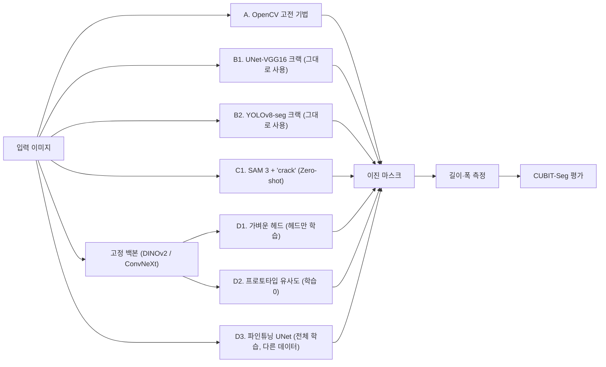

# 균열 탐지 & 길이·폭 추정 — 로드맵 v4

**조건**: 평일 하루 2~3시간 × 4주 (20회) · RTX 4060 (8GB) · 비용 0원 · 웹 데모 포함
**허용 범위 해석 (과제 해석 ②)**: 처음부터 학습(scratch)은 금지. **사전학습 모델을 CUBIT이 아닌 데이터로 파인튜닝하는 것은 허용.** 그대로 사용·특징 추출·파인튜닝을 모두 쓰고 비교함.

---

## 0. 지켜야 할 규칙 (README에 그대로 명시)

> [!IMPORTANT]
> 1. **CUBIT 데이터는 평가에만 사용.** 학습·검증·하이퍼파라미터 튜닝에 쓰지 않음
> 2. **Scratch 학습 금지.** 모든 학습은 반드시 사전학습 가중치(ImageNet 등)에서 출발
> 3. **학습(헤드 학습·파인튜닝)은 다른 공개 균열 데이터셋으로만**, 검증·튜닝은 그 데이터셋의 검증 분할로만
> 4. 방법마다 **학습한 파라미터 수를 표로 공개** (그대로 사용 = 0, 특징 추출 = 헤드만, 파인튜닝 = 전체)

이렇게 하면 "직접 학습 금지 + 전이학습 허용"에 맞고, **학습량에 따른 도메인 일반화(cross-dataset) 비교**라는 좋은 스토리가 됩니다: *"학습을 0 → 헤드만 → 전체로 늘릴 때, 처음 보는 CUBIT에서 성능이 얼마나 오르나?"*

---

## 1. 비교할 방법

| ID | 방법 | 전이학습 유형 | 우리가 학습하는 부분 | 우선순위 |
|---|---|---|---|---|
| A | OpenCV (CLAHE → Black-hat → 임계값 → 모폴로지) | — | 없음 | 필수 (베이스라인) |
| B1 | UNet-VGG16 크랙 가중치 (`khanhha/crack_segmentation`) | 그대로 사용 | 없음 | 필수 |
| B2 | YOLOv8-seg 크랙 (`OpenSistemas/YOLOv8-crack-seg`) | 그대로 사용 | 없음 | 선택 |
| D1 | 고정 백본 + 가벼운 헤드 | 특징 추출 | 헤드만 | 필수 |
| **D3** | **ImageNet 사전학습 UNet을 공개 균열 데이터로 파인튜닝** | **파인튜닝** | **전체** | **필수 (최고 성능 후보)** |
| D2 | 고정 백본 + 크랙 프로토타입 코사인 유사도 | 특징 추출 (학습 없음) | 없음 | 선택 |
| C1 | SAM 3 텍스트 프롬프트 | Zero-shot | 없음 | 선택 |

> B1·B2·C1 설명은 v2와 같습니다. (B1: 픽셀 단위로 정밀해서 폭 측정에 유리 / B2: 객체 분리는 되지만 마스크가 뭉툭함 / C1: 텍스트만으로 분할하지만 얇은 구조에 약함)

### D3 — 파인튜닝 (새로 추가)
- **모델**: `segmentation_models_pytorch`의 UNet + **ImageNet 사전학습 인코더** (ResNet34 또는 ConvNeXt-T, D1과 같은 백본으로 맞추면 비교가 깔끔함)
- **학습 데이터**: DeepCrack + CRACK500 + Masonry (D1과 동일, CUBIT 제외)
- **학습 방식**: 처음 몇 epoch은 인코더를 고정하고 디코더만 학습 → 이후 전체를 낮은 학습률로 학습 (사전학습 지식이 망가지는 것 방지)
- **RTX 4060**: 512px, 배치 8, AMP(혼합 정밀도) 사용 시 데이터 약 4~5천 장 기준 **1~3시간 예상** → 저녁에 걸어두고 다음 날 결과 확인
- **D3b (선택)**: B1(이미 도로 균열로 학습됨)을 **건물 외벽 데이터(Masonry)로 추가 파인튜닝** → "도메인 적응" 효과 확인
- **핵심 비교**: D1(백본 고정) vs D3(전체 학습)을 **같은 백본, 같은 데이터**로 → 순수하게 "백본까지 학습하는 효과"만 분리해서 볼 수 있음

---

## 2. D1 — 특징 추출 + 가벼운 헤드 (자세히)

### 아이디어
"사진을 잘 이해하는 눈(백본)"은 대형 사전학습 모델 것을 **그대로 빌려 쓰고**, "이 픽셀이 크랙인가?"를 판단하는 **아주 작은 판단기(헤드)**만 다른 크랙 데이터로 가르칩니다.

### 백본 후보 (모두 고정)
| 백본 | 특징 | 크랙 관점 |
|---|---|---|
| **DINOv2 ViT-S/14** ⭐ | Meta의 자기지도 학습 모델. 범용 특징이 매우 강함 (~22M 파라미터) | 패치가 14px 단위라 **특징 해상도가 낮음** (512px 입력 → 37×37) → 얇은 크랙이 뭉개질 위험 |
| **ConvNeXt-T / ResNet-50 (ImageNet)** | CNN이라 **얕은 층의 해상도가 높음** (1/4 해상도) | **얇은 크랙에 유리** |

→ 두 백본을 비교하는 것 자체가 실험 포인트입니다: *"트랜스포머의 의미 정보 vs CNN의 고해상도 정보, 얇은 크랙에는 무엇이 나은가?"*

### 헤드 설계 (가볍게)
- **Hypercolumn + 1×1 Conv**: CNN 백본의 여러 층(1/4, 1/8, 1/16) 특징을 같은 크기로 업샘플해서 이어붙이고 → 1×1 conv 2개로 픽셀별 크랙 확률 출력
  - 학습 파라미터: 약 **5만~20만 개** (백본 2,800만 개 대비 1% 미만)
- **DINOv2 + Linear probe**: 패치 특징 → 선형층 → 업샘플. 가장 단순한 형태
- (비교용) 헤드 크기 Ablation: Linear vs 1×1 Conv 2층 vs 3×3 Conv 2층

### 헤드 학습 데이터 (CUBIT 제외, 공개 데이터셋)
| 데이터셋 | 장수 | 도메인 | 역할 |
|---|---|---|---|
| **DeepCrack** | 537 | 혼합 (건물·도로) | 메인 |
| **CRACK500** | ~3,368 | 도로 | 양 확보 |
| **Masonry / Bai-2020** | 수백~수천 | **건물 외벽** | CUBIT(건물 외벽)과 도메인이 가까움 → 효과 비교 |

- 모두 CUHK 레포의 "Segmentation-Oriented Defect Dataset" 표에 링크가 있습니다.
- 실험: **"도로 데이터로만 학습한 헤드 vs 건물 데이터를 섞은 헤드"**의 CUBIT 성능 비교 → 도메인 차이 분석

### 효율 포인트 (RTX 4060에 딱 맞음)
- 백본이 고정이라 **특징을 한 번만 뽑아서 디스크에 저장(캐싱)** → 헤드 학습은 수 분 안에 끝남
- VRAM 사용량이 작음 (역전파가 헤드에서만 일어남)

### D2 — 학습 0 변형 (선택)
- 다른 데이터셋의 크랙 픽셀 특징 평균 = "크랙 프로토타입 벡터"
- CUBIT 이미지의 각 픽셀 특징과 코사인 유사도 계산 → 임계값으로 분할
- 학습 없이 특징만 쓰는 ② 방식. D1과 비교하면 "헤드 학습이 얼마나 기여하는가"를 보여줄 수 있음

---

## 3. 길이·폭 측정 (모든 방법 공통) — v2와 동일
1. 후처리: 작은 조각 제거, closing으로 끊긴 부분 연결
2. 연결 요소로 균열 객체 분리
3. **길이**: skeleton → 이웃이 가로·세로면 1, 대각선이면 √2로 합산 → 잔가지 제거
4. **폭**: distanceTransform × 2를 골격 위에서 읽어 최대 / 평균 / 분포 산출
5. **정답**: GT 마스크에 같은 알고리즘 적용 → 예측과 비교 (MAE, MAPE)
6. 단위: 픽셀 (`mm_per_px` 옵션 제공, 한계는 README에 명시)

---

## 4. 평가 지표
- **분할**: IoU, F1, Precision, Recall, 허용오차 2px F1
- **측정**: 길이 MAPE, 폭 MAE (px)
- **효율**: 이미지당 추론 시간, **학습한 파라미터 수** (A·B·C·D2 = 0, D1 = 헤드만, D3 = 전체)

---

## 5. 4주 일정 (평일 20회)

### 1주차 — 기반
| Day | 작업 | 완료 기준 |
|---|---|---|
| 1 | conda + PyTorch CUDA, GitHub 레포, `.gitignore` | GPU 인식 |
| 2 | 데이터 다운로드: CUBIT-Seg(평가용) + DeepCrack, CRACK500, Masonry(학습용). 가중치 확보 (B1, B2) | 데이터와 가중치 모두 확보 |
| 3 | EDA: 데이터셋별 크랙 폭·면적 분포 비교 (도메인 차이 시각화) | `01_eda.ipynb` |
| 4 | 평가 모듈 (`metrics.py`) | 테스트 통과 |
| 5 | 측정 모듈 (`measure.py`) + GT 길이·폭 CSV | `gt_measure.csv` |

### 2주차 — 학습 없는 방법들
| Day | 작업 | 완료 기준 |
|---|---|---|
| 6 | A. OpenCV 베이스라인 | 첫 수치 |
| 7 | B1. UNet-VGG16 (그대로 사용) | 비교표에 추가 |
| 8 | B2. YOLOv8-seg (선택) 또는 C1. SAM 3 (선택) | 비교표에 추가 |
| 9 | 방법별 측정 오차 평가 + 임계값 민감도 | 측정 오차표 |
| 10 | 버퍼 + 리팩토링 | — |

### 3주차 — 특징 추출(D1) vs 파인튜닝(D3) 비교 ⭐
| Day | 작업 | 완료 기준 |
|---|---|---|
| 11 | 백본 로드(ConvNeXt-T, ResNet34), D1 헤드 구현 + 특징 캐싱 후 학습 | D1 가중치 저장, CUBIT 평가 |
| 12 | **D3 파인튜닝 파이프라인** (`segmentation_models_pytorch` UNet + AMP) 구현 및 학습 실행 (DeepCrack+CRACK500+Masonry) | D3 가중치 저장 |
| 13 | D3 CUBIT 평가 + **핵심 비교 실험**: ① 그대로 사용(B1) vs ② 특징 추출(D1) vs ③ 파인튜닝(D3) 및 학습 도메인(도로 vs 도로+건물) 비교 | 비교표 & Ablation 표 완성 |
| 14 | (선택) D3b(B1을 건물 데이터로 추가 파인튜닝) 또는 D2/C1 중 시간 되는 것 | 비교표에 추가 |
| 15 | 실패 사례 분석 + 최종 방법 선정 | `failure_cases.md`, 최종 비교표 |

### 4주차 — 데모 + 정리
| Day | 작업 | 완료 기준 |
|---|---|---|
| 16 | 시각화: 오버레이, 골격, 폭 히트맵, 객체 라벨 | `assets/` |
| 17 | `infer.py` CLI + CUBIT-Det 고해상도 타일링 데모 (선택) | 결과 이미지 |
| 18 | Gradio 앱 (A, B1, D1, D3 선택 가능) | 로컬 동작 |
| 19 | HF Spaces(무료 CPU) 배포 + README | 공개 URL |
| 20 | 재현 테스트, `v1.0` 릴리즈, 이력서 수치 채우기 | 완료 |

> [!TIP]
> 일정이 밀리면 이 순서로 빼면 됩니다: 타일링 데모 → D2/C1/B2 → D3b. 최소 완성 조건은 **A + B1 + D1 + D3 + 측정 + 평가 + 데모**입니다.

---

## 6. 무료 웹 데모
- **HuggingFace Spaces 무료 CPU** (2 vCPU, 16GB) + Gradio
- 데모 탑재: A (OpenCV), B1 (남이 학습한 UNet), D1 (특징 추출), **D3 (우리가 파인튜닝한 UNet)**. 모두 CPU에서 512px 기준 수 초 이내 동작

---

## 7. 리스크 & 대응
| 리스크 | 대응 |
|---|---|
| 학습용 공개 데이터 링크가 죽음 | CUHK 표의 다른 건물 데이터셋으로 대체 (CCIC-600, Bai-2021 등) |
| 파인튜닝(D3) 시 학습 데이터에 과적합되어 CUBIT에서 오히려 성능 하락 | 초반 인코더 freeze + 낮은 학습률 + 강한 색상/조명 증강(ColorJitter, CLAHE)으로 도메인 일반화 유도 |
| DINOv2 해상도가 낮아 얇은 크랙을 놓침 | CNN 백본(ResNet34 / ConvNeXt-T)을 메인으로 사용 |
| B1 가중치를 받을 수 없음 | DeepCrack 사전학습 가중치로 대체 |

---

## 8. 이력서 문구 (수치는 완성 후 채우기)
- 전이학습의 3단계(**그대로 사용 → 백본 고정 특징 추출 → 전체 파인튜닝**)를 공개 균열 데이터셋으로 구현하고, **학습에 쓰지 않은 건물 외벽 데이터셋(CUBIT-Seg 5,462장)**에서 도메인 일반화 성능을 정량 비교
- 고전 비전(OpenCV) 대비 F1 **+xx%p**, 특징 추출 대비 파인튜닝으로 **+x.x%p** 향상 및 도로→건물 도메인 적응 효과 규명
- Skeleton·Distance Transform 기반 균열 길이·폭 추정 알고리즘 설계, GT 대비 길이 MAPE **xx%**, 폭 MAE **x.x px** 달성
- Gradio + HuggingFace Spaces로 무료 웹 데모 배포
